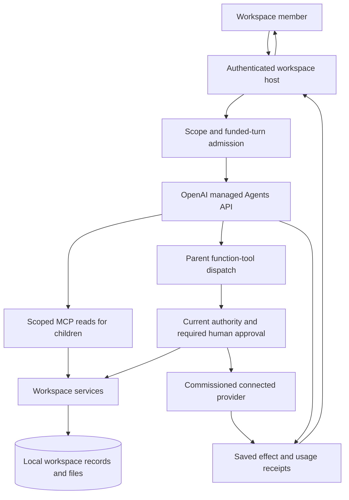

# Architecture

Agent workspace is the existing Vitrina Harness, packaged as a clean developer source release. It keeps three explicit layers:

| Layer | Responsibility | Entry points |
|---|---|---|
| Managed core | OpenAI's agent loop, hosted execution, sessions and stock children | `harness/runtime/managed_codex.py`, `managed_runtime.py` |
| Workspace framework | Persistence, members, conversations, files, tools, connections, recipes, signals, approvals and spending | `harness/mechanics/`, `harness/sdk/`, `harness/server.py`, `harness/web/` |
| Vertical | A business role, prompts, classes, tools, input providers and optional pages | `harness/verticals/bare/`, `harness/verticals/retail/` |

`layout.py` installs only runtime, mechanics, SDK and the selected vertical. Flat module names remain unique across these paths. The bare vertical is tested with retail source files and heavy packages physically unavailable. A saved `.workspace-template.json` binds each state directory to its original vertical.

## Request and approval flow

The host owns durable workspace records, tool policy and accounting. OpenAI owns the agent loop and hosted execution. A connected provider performs its admitted external action. The approval router binds a human decision to that exact action and current revision; granted reads use their existing scope. Stop and revocation withdraw the original request's authority and reconcile its provider work.

Source: [managed runtime](../harness/runtime/managed_runtime.py), [tool dispatch](../harness/runtime/managed_turn.py), [managed MCP](../harness/mechanics/managed_mcp.py), [approval router](../harness/mechanics/managed_connections.py) and [spending policy](../harness/runtime/managed_policy.py).

## A managed turn

1. An authenticated workspace member submits an exact user request through the shared page.
2. Conversation, actor, scope, request identity and provider session binding are recorded durably.
3. Existing company funds and per-turn limits are reserved before paid execution.
4. The adapter submits the admitted tools, role instructions and public managed MCP endpoint to OpenAI's hosted core.
5. Tool dispatch journals the provider call identity before effects, checks current admission around awaited work and returns saved results on replay.
6. Events project into durable conversation messages and host-owned files. Raw provider payloads and credentials stay server-side.
7. Stop/revocation retires the root and descendants; uncertain provider quiescence or charges keep their holds for reconciliation.

The shared framework uses file stores and SQLite for much of its durable behavior. Retail's maintained read closure additionally includes PostgreSQL migrations/read models. It is an optional vertical boundary, rather than a dependency of the bare process.

## Jobs, signals and effects

A recipe describes one complete job with ordered prerequisites and completion evidence. A named role declares its permitted tools, model, effort, deadline and portion of its parent's budget. A ready-made agent is a saved job definition. Skills teach a source or connection; they are distinct from recipes and display sets.

Durable intervals, timers and signed webhooks become signals. Scope filters, deterministic conditions, optional funded screening and scripts precede delivery. Current membership, authority, revision, expiry and daily limits are rechecked during scheduling and dispatch. Writes to connected systems require the relevant commissioned connection and action-bound approval.

## Boundaries that shaped the design

- **Managed core:** OpenAI operates execution; the repository implements workspace behavior and an explicit protocol adapter. See [decision 0013](decisions/0013-managed-agent-core.md).
- **One state owner:** vertical binding, company scope and current membership travel through tool invocation and replay. The browser cannot select a different owner through tool arguments.
- **Durable effects:** saved identities prevent replay from repeating a completed effect. Authority withdrawal can withhold later results even when an already-running read finishes.
- **Funds before inference:** host-only funding/authorization records feed an immutable company-bound ledger. Application routes and agents cannot add funds.
- **Source-selected extensions:** a vertical owns its domain modules and assets; shared mechanics consume SDK interfaces and callbacks. Orders/customer products retain their separate boundaries.
- **Optional compute:** the retained gVisor/custom-executor broker sources support bounded connector/script jobs. They are separately commissioned services; OpenAI hosts the agent core.

## Source release and omissions

This clean tree includes the shared framework, bare vertical, source-only retail extension, synthetic SDK test verticals, required shared UI assets and maintained retail backend closure. Client-specific manufacturer source is prepared as a separate product. Camera footage, imported datasets, benchmark receipts, customer state, provider grants, owner target configuration and historical deployment evidence are outside this source export. The historical source remains privately preserved.

The packager uses Git's tracked inventory in a checkout. A clean archive without `.git` uses `provenance/release-files.json`, with confined relative paths. This preserves explicit source selection instead of copying arbitrary state from the filesystem.

The public source modifies portable setup and documentation; it preserves the managed adapter, scope checks, accounting and selected-vertical interface. `provenance/source-export.json` records original file hashes and omissions, and the release manifest records the final reviewed bytes.
