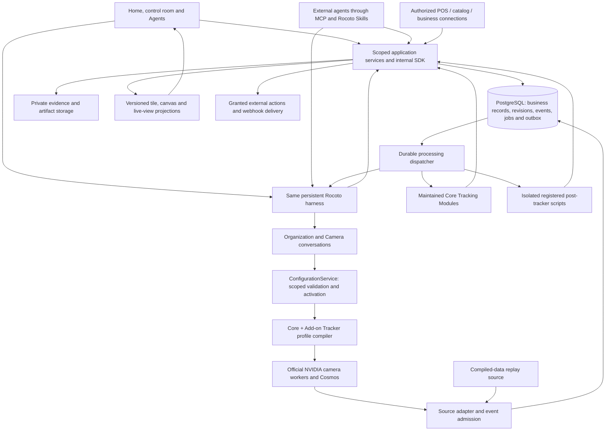

# Retail service target design

Dated design checkpoint, 9–11 October 2026, retained from the original Vitrina Harness. This is a retail target contract. The current public implementation and managed OpenAI runtime are described in [Architecture](../../docs/ARCHITECTURE.md), [MCP](../mechanics/MCP.md) and the [SDK](../sdk/README.md). Historical “current” statements below refer to their original checkpoint; each implementation or deployment needs its own present verification.

The structure that exists is in [README](../README.md): the four layers, the module map in
`layers.py` and the table of what works today. This document is the target for the data and
service boundary: one PostgreSQL authority, shared application services and isolated workers.
Read [the harness](../../docs/HISTORICAL-RECORDS.md#record-2) for each capability's present state.

**Target architecture, October 9, 2026.** [Product](../../docs/HISTORICAL-RECORDS.md#record-28) owns the selected behavior;
[Delivery status](../../docs/HISTORICAL-RECORDS.md#record-33) owns verified reality. The current prototype has reusable
components and several SQLite stores. This document defines the production structure to migrate
toward; it does not claim that migration, new MCP writes or live ingest are already deployed.

## System structure

Use a modular application service with one PostgreSQL business-data authority, private media/artifact
storage and separately isolated workers. Browser, native harness and MCP adapters invoke the same
application services. Durable event admission and processing contracts are the central boundary.
Kafka, a particular GPU host and model prompt syntax are replaceable adapters.

The front end reads projections and subscribes to committed changes. It does not define basket,
stock, timing or sales rules. Charts and agent-generated canvases consume the same output contract.

## Service ownership

| Boundary | Owns | Durable contract |
| --- | --- | --- |
| Identity and business | Existing company/member/demo identities; locations, rooms, contacts and grants | Tenant-qualified IDs, scope, versioned business context |
| Onboarding | Persistent Organization/Camera conversations, structured questions, secure intake, readiness and recovery | Onboarding step, question/answer resolution, connection/calibration receipts |
| Tracking configuration | Typed business-intent requirements/proposals from the hosted harness, business playbooks; Core/Add-on definitions and dependencies; camera-profile compilation | Immutable definitions/bindings, validation, desired and acknowledged active worker revisions |
| Observation admission | Source registration, exact clocks, person-reference mapping, schema/provenance checks and quarantine | Canonical accepted event or rejection receipt; input bytes/revision and deduplication key |
| Catalog and transactions | Catalog imports, provisional products, bounded image matching, physical items, price provenance and POS records | Candidate/confirmed links; source transaction keys; currency and time-valid prices |
| Processing | Core Module revisions, customer processors, state projection, run scheduling and checkpoints | Immutable processing revision, trigger, lease, inputs, outputs and failure state |
| Agent harness | Persistent chats, mode promotion, role instructions, skills, tool turns and scoped subagents | Conversation identity, run history, grants, budget admission and Stop |
| Presentation | Shared kit, maintained module canvases, validated custom canvas packages and projections | Component/data schema, tile/canvas revision, approved bindings, accessible render |
| Delivery | Alerts, participant phone delivery, external subscriptions, connector/computer effects and receipts | Outbox, idempotency/reconciliation, participant binding or delivery grant, daily message caps and bounded retries |

Each module owns its writes through typed service commands. A source adapter, agent-generated
script or model response cannot bypass that boundary by writing arbitrary database rows.

## Database and storage

[Data contracts](POSTGRES-SCHEMA.md) specifies entity keys, relationships, event envelopes, transactions
and migration. Production uses the existing company identity as its tenant authority and PostgreSQL
for transactional records. Avoid parallel definitions of a company, catalog or conversation.
Current store names are migration inputs, not reasons to preserve a fragmented model.

Private object storage holds media, original model input/output receipts, dense track geometry,
source crops, generated reports and approved code/presentation artifacts. PostgreSQL holds scoped
metadata, checksums and references. High-rate frames/tracks can be stored in bounded chunks with
indexed time ranges; they are not individual chat messages or an unbounded JSON row.

Use ordinary relational indexes first: tenant/location/time, tracker/revision/time, visit/event,
product/event and processor/checkpoint. Embeddings may later help a bounded catalog candidate
lookup if measured useful; they are not the authority for SKU identity or required for the event
pipeline. Retired whole-archive semantic search stays outside the release path.

Row-level policies supplement service authorization. Application roles must not own tables or
have bypass privileges; migration/administration roles remain separate. Owner/bypass exceptions
require explicit testing, not an assumption that setting `tenant_id` is sufficient.
[PostgreSQL row security](https://www.postgresql.org/docs/current/ddl-rowsecurity.html).

## Observation execution

The selected GPU adapter uses NVIDIA's official DeepStream person detection/tracking and
`nvvllmvlm` reference path. NVIDIA supports configurable video segments, per-stream prompts and a
`vlm-result` signal carrying stream ID, interval and text. The host converts this output into its
validated event envelope; the plugin does not itself provide Rocoto's product schema or SKU
catalog. [Official VLM reference](https://docs.nvidia.com/metropolis/deepstream/dev-guide/text/DS_ref_app_vllm_plugin.html).

The October 9 trial used stock-rendered person IDs in the model's video input. This is different
from a guarantee that hidden DeepStream object metadata reaches Cosmos or that every emitted
person ID is correct. Admission verifies output identities/times against actual input receipts.
The existing thin bridge is integration work; the revised full contract still needs a GPU proof.

The official VLM reference includes `vllm_ds_app_kafka_publish.py` and a sample Kafka consumer.
This is one supported result-transport path. Separately, `nvmsgbroker` is NVIDIA's messaging sink
with Kafka, Redis Streams and other adapters. Neither supplies Rocoto's business admission/schema,
module processing or agent lifecycle. [Official VLM reference](https://docs.nvidia.com/metropolis/deepstream/dev-guide/text/DS_ref_app_vllm_plugin.html),
[official message broker](https://docs.nvidia.com/metropolis/deepstream/dev-guide/text/DS_plugin_gst-nvmsgbroker.html).

The candidate `connect_stock_results` bridge attaches to the native `vlm-result` signal. A Kafka
consumer or that direct callback must pass the same original result, pinned profile, source clock
and actual input receipts into admission. A broker acknowledgment follows durable inbox/receipt
storage; a retry cannot produce another accepted occurrence. Rejected results retain quarantine
state and a receipt so that a poison message does not retry indefinitely. Processing consumers read
accepted records/cursors through the SDK; they do not implement separate Kafka-specific domain logic.

Multi-camera tracking has its own stock NVIDIA communication path: MV3DT uses MQTT between
calibrated vision-neighbor cameras to share state and propagate/correct IDs. That transport belongs
to the camera tracking pipeline. Rocoto admits its explicit association and measurement receipts
through the same service boundary; Kafka remains an optional downstream transport for observations.
Partial camera overlap is supported by the neighbor graph; all cameras need not see every visitor.

The current development path has no commissioned Kafka consumer. Begin with the bounded result
adapter and durable application queue; use the official publishing/broker path when transport needs
justify it. Pin the tested NVIDIA revision in the worker receipt; a newer documentation example
does not silently upgrade a running worker. The shared event/SDK contract is required whichever
transport is selected, including GPU-free compiled-data replay.

Core and Add-on Trackers compile into a shared camera profile. Consumers reference definitions,
not separate GPU calls per tile/agent. The host checks dependencies, output schema, coverage,
budget and profile size before activation. Old profile remains active until the worker acknowledges
the next revision at a segment boundary. A revised Tracker applies prospectively; historical
reprocessing is explicit, separately budgeted work. Prompt edits do not rewrite old evidence.

## Business-intent configuration boundary

Customer-facing services are **Rocoto Real-time**. Expose business interests, proposed diffs,
readiness and activation receipts; keep model/plugin names, raw prompts, machine addresses and
private profile contents out of customer tools and errors. Provider/legal disclosures retain their
actual operating records and applicable delivery requirements.

The same hosted Organization/Camera harness conversations receive requests from Rocoto's app or
an authorized external agent through MCP. The internal `ConfigurationService` handles requirements
→ draft/proposal → validation → authorized activation. It compiles shared observation dependencies
and pins desired/active revisions. Its caller submits business intent and supported typed fields,
never arbitrary worker configuration. Host policy protects Core coverage and budgets regardless of
whether a request required model interpretation. Supported deterministic commands share this boundary.

A dormant conversation keeps its thread and unresolved questions. An admitted message, reply or
commissioning failure wakes a bounded run; the harness issues typed service commands and then
returns to idle. Stop, grants, conflicts, question expiry and financial admission still apply. Keep
one canonical setup history across app/MCP entry points rather than spawning another agent for
each transport. Observation and scheduled processing continue independently on Rocoto's server.

## Processing and wakeups

Accepted observations and the related dispatch/outbox rows commit in one transaction. Workers
claim bounded jobs with leases, heartbeats and retry state. Database-backed queue claims can use
row locks/`SKIP LOCKED`; this is queue coordination, not a promise of globally ordered events.
[PostgreSQL SELECT](https://www.postgresql.org/docs/current/sql-select.html).

Delivery is at least once. Idempotent application writes, revision-scoped checkpoints and input
keys prevent duplicate projected baskets, module rows and alerts. An event correction references
the earlier event and triggers affected projections. Late data retains event time and ingest time;
summary windows disclose completeness and any correction. External effects may still be uncertain
when a provider does not offer idempotency; reconciliation precedes automatic retry.

Core Tracking Modules execute maintained code. Custom Tracking Agents register bounded scripts
for automatic post-event processing or run analysis when awakened on an event, batch or schedule.
A persisted conversation is not a continuously running model. Separate deterministic work from
model interpretation and from infrequent canvas-design work. Record each run's configuration,
event cursor, input evidence, cost reservation, outputs and result state.

## Execution policy and processed alerts

A versioned execution policy separates observation bindings, automatic processor activation,
target-agent wake mode and subscription delivery. An edit-only request changes permitted definitions
through the same harness/service boundary and records `wake_target_agent: false`. Its configuration
conversation may run a bounded turn; the target agent's analysis does not. Updating configuration
also does not implicitly backfill historical data. Existing grants authorize routine changes; new
spend or authority follows host admission. Mandatory Core bindings remain protected.

Participant phone delivery is one more independent setting, on by default for a Tracking Agent. The
host delivery worker fans each processed alert revision out to the agent's participants on their
verified phones, one stable delivery ID per participant and alert revision, in the channel order
Viber, SMS, then WhatsApp where commissioned. It runs outside every agent turn and leaves the
agent's run as it is. An edit-only change, a paused delivery policy and the compiled-data replay
lane each produce zero sends. [Channels](../../docs/HISTORICAL-RECORDS.md#record-24) owns the contract.

A customer can keep camera observation and a registered post-event processor active, disable hosted
agent wakes/actions, and deliver the processor's alerts externally. Internal scheduler consumers and
external subscriptions use one canonical alert/outbox stream, with event ID, revision, input lineage,
processor revision and scope. Delivery representations contain only fields allowed to the recipient.
Separate internal queues and external signed webhooks can transport that same contract.

A custom POS reconciliation processor performs a bounded temporal/catalog/amount match using
validated connector records. It stores matching-window state and connector completeness/watermarks.
Before the window closes it stays pending; unavailable or incomplete coverage remains unknown.
Only sufficient coverage plus no qualifying candidate yields an unmatched alert, explaining the rule
and relevant evidence. A late match corrects/resolves the same occurrence. Lease/retry keys prevent
duplicate alerts; an action consumer handles revisions before irreversible effects. Observations,
transaction facts and the processor's derived matching decision retain distinct provenance.

## Harness and access

Keep the native Codex conversation engine behind the contract [Agent runtime](../../docs/HISTORICAL-RECORDS.md#record-30) states:
what runs today, and the eight things another runtime has to provide. Today the runtime adapter,
the tool registry and the dispatcher share `agent_bridge.py`; a separate adapter module is the
target. At this checkpoint, the commissioned path was self-hosted app-server with a funded company API
gateway. The source release now uses the managed OpenAI core described in the current Architecture guide.
[Runtime options](../../docs/HISTORICAL-RECORDS.md#record-21).

The harness calls [Internal SDK](../../docs/HISTORICAL-RECORDS.md#record-23) services. Isolated scripts receive scoped data
handles, schemas, CPU/memory/time/output limits and narrow result-write capabilities. Internal
service credentials stay outside model-visible workspaces. API requests recheck company membership,
source grants, tool capabilities and budget; co-location supplies no extra authority.

App and [MCP](MCP-WRITES.md) expose the same Rocoto harness, conversations and business services.
An external agent acts as a delegated caller; it does not replace Rocoto's runtime. Public MCP
currently exposes reads. Conversation commands, questions, changes and result/subscription flows
are required target work. Reads and supported deterministic commands need no extra model turn.
Conversation IDs and run handles survive transport disconnects, while reads and mutations recheck
authority. Secure input uses purpose-bound private forms/URLs. Human or model text cannot mint a
credential grant. Client transport capabilities determine notification/polling behavior, not the
lifetime of server-side monitoring or durable jobs.

Tracking Agents reach their own participants by phone as a default capability: the creator and the
company members that creator adds, each on a verified number, through Rocoto's own channel account
commissioned once by the host for the environment. The host resolves every recipient from the
agent's participant bindings and bounds sends with per-company and per-agent daily message caps,
Stop and a fail-closed cap read.

Action Agents additionally receive explicit effect capabilities. A messaging channel and recipient
outside the agent's participants, an operation type, financial limit and expiry form the grant.
API-based effects and computer-use jobs retain the same permission, audit, Stop and uncertainty
rules. A connected logo or installed skill does not establish provider support or a granted action.

## Compiled-data replay

The debug source replays preserved, already processed data through the same source admission,
event transactions, processors, jobs and browser subscriptions as live input. It uses no inference
GPU. Canonical source time remains unchanged; a separate simulation clock schedules arrival.
Each run/loop has explicit occurrence and visit identity so legitimate repeated scenes differ from
retries. The original footage remains the evidence reference.

Replay runs in a dedicated demo/test scope, has bounded lifetime/storage/retention, supports
pause/rate/seek/restart and resumes with durable checkpoints. Seek/rewind creates or resets an
explicit simulation run rather than mutating actual history. External effects are disabled by
default and require a separately authorized test sink; phone delivery stays at zero sends in the
replay lane. Raw quarantined model outputs cannot enter
business projections just because replay is selected. Clearly identified fixtures may exercise
empty capability paths separately from actual accepted evidence.

## Production migration and release

1. Inventory current SQLite records, source blobs, consumers and native conversation identities.
2. Add canonical PostgreSQL schema/migrations and service adapters with tenant tests and constraints.
3. Copy a private demo snapshot, preserving IDs, provenance, revisions and history; reconcile counts,
   constraints, hashes, event cursors and basket/stock projections. Do not silently promote drafts.
4. Cut over one consumer/source at a time with one declared write authority. Use read-only parity
   comparisons and an explicit bounded delta; avoid unbounded dual writes.
5. Exercise compiled-data replay, restart/retry/correction, actual onboarding, GPU admission and
   customer connection flows through the same SDK. Verify backup restore and compatibility rollback.
6. Pass privacy, cost, observation quality, user access, load/capacity and guarded release checks.

This document authorizes an implementation plan, not an immediate production database mutation.
[Delivery plan](../../docs/HISTORICAL-RECORDS.md#record-22) tracks each migration and feature gate. The existing protected
release chain and separate company account boundaries continue to govern deployment.
